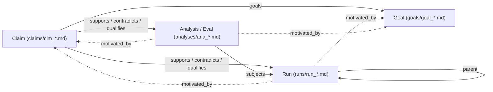

# Contour Architecture: State, Invariants & Operators

Contour models an empirical ML research project as a **versioned research state** $S$ stored in plain Markdown + YAML + Git, governed by three primitives:

1. **Research State Space ($S$):** The canonical set of configuration, belief, and evidence documents on disk—pure source-of-truth, with no persisted derived caches and no duplicated fields between YAML frontmatter and Markdown prose.
2. **Invariants ($\mathcal{I}(S)$):** Structural, hygiene, and semantic rules that distinguish trustworthy research states from corrupted or over-claimed ones (analogous to types, unit tests, and code review in a codebase).
3. **Operators ($T, \mathcal{O}$):**
   - **Transition Operators ($T: S \to S'$):** Mechanical and agentic/human mutations that advance the state while respecting $\mathcal{I}$.
   - **Observables ($\mathcal{O}(S)$):** Pure, read-only projections that extract comparisons, frontiers, briefings, ideation moves, and colleague-ready reports from $S$.

---

## 1. Research State Space & Schema ($S$)

The state $S$ partitions cleanly into three layers with different mutability expectations:

$$S = (\, S_{\text{config}},\; S_{\text{belief}},\; S_{\text{evidence}} \,)$$

- **$S_{\text{config}}$ (`contour.yaml`):** Project-wide metric vocabulary and diff-ignore policy.
- **$S_{\text{belief}}$ (`goals/`, `claims/`):** **Mutable / refactorable** representation of objectives, falsifiable claims, evidence links, verification locks, and open questions.
- **$S_{\text{evidence}}$ (`runs/`, `runs/configs/`, `analyses/`):** **Append-only** outputs produced by reproducible code/scripts. Post-hoc edits are limited to prose takeaways/observations or flagging `bugged: true`—never silently altering recorded metrics or configs.

**Identity by path (zero redundancy):** Both node **type** (`goal` | `claim` | `run` | `analysis`) and node **ID** (`filename` stem) are derived directly from the file path—so `id:` and `type:` are not required in YAML frontmatter and filename/ID drift is impossible by construction.

### 1.1 Directory Layout & Git Boundary

| Path | Layer | Git Tracked | Purpose |
| :--- | :--- | :--- | :--- |
| `contour.yaml` | $S_{\text{config}}$ | Yes | Metric vocabulary and ignored config keys |
| `goals/goal_<slug>.md` | $S_{\text{belief}}$ | Yes | Top-level objectives, synthesis, and open questions |
| `claims/clm_<slug>.md` | $S_{\text{belief}}$ | Yes | Falsifiable claims, evidence links, and verification lock |
| `runs/run_<YYYYMMDD>_<8hex>.md` | $S_{\text{evidence}}$ | Yes | Lean training run records (~12–15 lines of YAML + prose) |
| `runs/configs/<run_id>.yaml` | $S_{\text{evidence}}$ | Yes | Sidecar full training configs (model, optimizer, datasets, sampling) |
| `analyses/ana_<YYYYMMDD>_<8hex>.md` | $S_{\text{evidence}}$ | Yes | Post-hoc evals (`kind: eval`) and ad-hoc analyses (`kind: analysis`) |
| `analyses/scripts/` | Local workspace | **No** (gitignored) | Dedicated scratch home for ad-hoc analysis scripts (`exploratory` until promoted/tracked in Git) |
| `analyses/artifacts/` | Local workspace | **No** (gitignored) | Local plots, CSV/JSON tables, and heavy diagnostic outputs |

### 1.2 Graph Topology (Single-Direction Links)

Every structural edge is stored on **exactly one side** using `[[node_id]]` wikilinks (no duplicated inverse lists to fall out of sync):

---

### 1.3 Configuration Schema (`contour.yaml`)

| Field | Type | Required | Default / Notes |
| :--- | :--- | :--- | :--- |
| `contour` | `int` | Yes | Format version (`1`). |
| `ignored_config_keys` | `list[str]` | No | Default `[seed, num_workers, log_interval, eval_interval, checkpoint_dir]`. Matches exact dot-paths, prefixes, or leaf keys in nested configs. |
| `metrics` | `dict[str, MetricSpec]` | No | Declares benchmark/eval metric keys matching `^[A-Za-z0-9_.-]+/[a-z0-9_]+$`. |

**`MetricSpec` fields:**
- `direction`: `'max' | 'min'` (required)
- `kind`: `'quality' | 'cost' | 'diagnostic'` (required)
- `primary`: `bool` (optional, default `false`; for `kind: quality`—selects the headline metric(s) for verdicts, Pareto `frontier`, and compact summaries; non-primary quality metrics act as regression guardrails)
- `min_delta`: `float >= 0` (absolute threshold $\tau$, e.g., `0.20` top-1 points)
- `min_rel_delta`: `float >= 0` (relative percentage threshold as a fraction, e.g., `0.05` = 5%, useful for throughput, latency, perplexity, or MSE)
- *At least one of `min_delta` or `min_rel_delta` is required for `quality` and `cost` metrics.*

---

### 1.4 Belief Layer Schemas ($S_{\text{belief}}$)

#### Goal (`goals/goal_<slug>.md`)
| Field | Type | Required | Notes |
| :--- | :--- | :--- | :--- |
| `title` | `str` | Yes | Concise objective title. |
| `status` | `'active' \| 'achieved' \| 'paused' \| 'abandoned'` | Yes | Lifecycle state. |

**Markdown body sections:**
- `## Objective & Success Criteria`
- `## Current Synthesis`
- `## Open Questions` — free-form Markdown bullets (`- ...`), parsed directly by `contour brief` and `contour report`.

#### Claim (`claims/clm_<slug>.md`)
Separates **belief** (`status`) from **rigor** (`verification`) so tentative claims and audited claims are never conflated.

| Field | Type | Required | Notes |
| :--- | :--- | :--- | :--- |
| `title` | `str` | Yes | Falsifiable claim statement. |
| `status` | `'active' \| 'supported' \| 'falsified' \| 'archived'` | Yes | Current epistemic belief state. (Edit/narrow claims in place; Git preserves history.) |
| `verification` | `'draft' \| 'agent_audited' \| 'human_verified'` | Yes | Rigor tier. Effective verification drops to `draft` whenever `verified_hash` is stale. |
| `verified_hash` | `str \| null` | No | 8-hex SHA-256 content hash over Claim frontmatter, **Claim Markdown body prose**, and linked evidence (including analysis subjects) to detect accidental drift. Omitted when `draft`. |
| `audit_note` | `str \| null` | No | Concise audit summary recorded by `contour verify` (surfaced in `contour brief`). |
| `goals` | `list[wikilink]` | No | Parent goal(s) (`[[goal_...]]`). |
| `supports` | `list[wikilink]` | No | Clean `run_*` / `ana_*` directly confirming the claim's prediction. |
| `contradicts` | `list[wikilink]` | No | Clean `run_*` / `ana_*` directly refuting the claim as stated. |
| `qualifies` | `list[wikilink]` | No | Informational context scoping, bounding, or explaining the claim (failure boundaries, tradeoffs, exploratory runs, ad-hoc diagnostic analyses). **Carries no weight in verification.** |

**Markdown body sections:**
- `## Hypothesis & Mechanism`
- `## Evidence Synthesis` — natural prose with `- **Holds:**`, `- **Breaks:**`, and `- **Untested / Caveats:**` (must cite `[[id]]` for every linked evidence node; covered by `verified_hash` and rendered directly into `contour report`).

---

### 1.5 Evidence Layer Schemas ($S_{\text{evidence}}$)

Both `Run` and `Analysis` split frontmatter into **author-owned keys** (preserved on re-write) and **logger-owned keys** (auto-captured by `Run` / `Analysis`). Empty, null, or default fields (including `bugged: false`) are omitted to keep files concise.

#### Artifact Entry Schema (Shared by `Run` & `Analysis`)
Each entry in `artifacts` is `{path: str, kind?: str, note?: str}` (e.g., `kind: checkpoint | log | plot | table | data`). `path` may be a local relative path (e.g., `analyses/artifacts/plot.png`) or a remote URI (`s3://...`, `gs://...`, `https://...`).

#### Training Run (`runs/run_<YYYYMMDD>_<8hex>.md`)
The researcher only supplies `title` (plus `config` and `track()` metrics); all logger-owned fields are captured automatically. Dataset splits, sampling weights, architecture details, and hyperparameters all live uniformly inside the sidecar `config`.

| Field | Owner | Type | Required | Notes |
| :--- | :--- | :--- | :--- | :--- |
| `title` | Author | `str` | Yes | Human-readable run title describing the experiment. |
| `bugged` | Author | `bool` | No | Omitted when valid. Set `bugged: true` to quarantine this run and propagate taint downstream. |
| `parent` | Author | `wikilink` | No | Optional baseline/parent run (`[[run_...]]`) for lineage trees and automatic diffing. |
| `motivated_by` | Author | `list[wikilink]` | No | Optional Goal(s) or Claim(s) that prompted launching this run. |
| `status` | Logger | `'running' \| 'final' \| 'failed'` | Yes | Written as `running` at startup, finalized on exit. |
| `created_at` / `finished_at` | Logger | ISO-8601 UTC `str` | Yes / No | Timestamps (`finished_at` set on close). |
| `config_path` / `config` | Logger | `str` / `dict` | No | `Run` writes tracked sidecar `runs/configs/<id>.yaml` and sets `config_path`; inline `config` dict is also supported (arbitrary nested mappings). |
| `compute` | Logger | `{num_gpus?, gpu_hours?, params?}` | No | Auto-captured compute metadata; surfaced as raw ratios in `compute_diff` and Pareto `frontier`. |
| `code` | Logger | `{commit: str\|null, dirty: bool, branch?: str}` | Yes | Git provenance of **source code** at launch time (excludes the Contour directory itself so uncommitted run/claim records do not mark code dirty). |
| `launch_cmd` | Logger | `str` | No | Exact command line used to launch the run. |
| `artifacts` | Logger | `list[Artifact]` | No | Live log paths (at startup) and saved checkpoints/outputs (on finish). |
| `metrics` | Logger | `dict[str, float]` | No | Final scalar metrics using `<scope>/<lowercase_name>` keys (primary metrics partition Pareto frontiers automatically). |

*Note:* Derived comparison fields (`vs_parent`) are **never persisted** in `runs/*.md`; they are computed dynamically as an Observable.

**Markdown body sections:** `## Key Takeaway (TL;DR)`, `## Observations & Anomalies`.

#### Analysis & Post-Hoc Evaluation (`analyses/ana_<YYYYMMDD>_<8hex>.md`)
| Field | Owner | Type | Required | Notes |
| :--- | :--- | :--- | :--- | :--- |
| `kind` | Author | `'analysis' \| 'eval'` | Yes | `'eval'` = standardized benchmark evaluation (composes into `compare`/`frontier`); `'analysis'` = ad-hoc diagnostic, mechanistic probe, or cross-run study. |
| `title` | Author | `str` | Yes | Concise analysis title. |
| `bugged` | Author | `bool` | No | Omitted when valid. Set `bugged: true` to quarantine. |
| `subjects` | Author | `list[wikilink]` | No | Zero, one, or $N$ upstream `[[run_...]]` nodes analyzed. |
| `motivated_by` | Author | `list[wikilink]` | No | Optional Goal(s) or Claim(s) that prompted this analysis. |
| `status` | Logger | `'running' \| 'final' \| 'failed'` | Yes | Execution lifecycle state. |
| `created_at` / `finished_at` | Logger | ISO-8601 UTC `str` | Yes / No | Timestamps. |
| `script` | Logger | `str` | No | Script path (e.g., gitignored `analyses/scripts/...` for ad-hoc probes, or a Git-tracked script for `clean` evidence). |
| `script_sha256` | Logger | `str` | No | 16-hex SHA-256 of `script` at execution time. |
| `script_tracked` | Logger | `bool` | No | Whether `script` was tracked and clean in Git at execution time. Untracked/gitignored scripts are `exploratory` until promoted into Git. |
| `code` | Logger | `{commit: str\|null, dirty: bool, branch?: str}` | Yes | Core repo git provenance at execution time (excludes the Contour directory itself). |
| `launch_cmd` | Logger | `str` | No | Exact invocation command (auto-captured from `sys.argv`; supports both zero-arg scripts and parameterized `eval.py --flag ...` harnesses). |
| `artifacts` | Logger | `list[Artifact]` | No | Output plots, CSV/JSON tables (typically under gitignored `analyses/artifacts/`). |
| `metrics` | Logger | `dict[str, float]` | No | Benchmark scalars (for `kind: eval`) or free-form diagnostic scalars (for `kind: analysis`). |

**Markdown body sections:** `## Key Takeaway (TL;DR)`, `## Findings & Observations`.

### 1.6 Remote / Cluster Run Ingestion
For jobs executed on a remote cluster without shared Git checkout write access, `Run.to_record()` / `Analysis.to_record()` serialize the canonical JSON record on the worker, and `ingest_record(root, record)` / `ingest_analysis_record(root, record)` materialize the Markdown + sidecar config cleanly back into the local Contour repo.

---

## 2. Invariants ($\mathcal{I}(S)$)

Invariants define what makes a research state $S$ valid and trustworthy. Like a software codebase, Contour separates invariants into **three tiers** so exploration stays fast while settled conclusions stay rigorous:

1. **Tier 1 — Structural Invariants (`ERROR`):** Analogous to a type checker / compiler. Must hold at all times; violation means $S$ is corrupted and blocks `contour check` and `contour verify`.
2. **Tier 2 — Quiescence & Epistemic Invariants (`WARN`):** Analogous to unit tests and linters. Transiently red hygiene checks act as a **work queue** (e.g., a newly finished run needing synthesis); epistemic checks gate `contour verify` and `contour report --strict`.
3. **Tier 3 — Semantic Invariants (Critic + Human Review):** Analogous to PR code review. Properties that require scientific judgment rather than YAML rules, content-hashed to $S$ by `verified_hash` once audited to catch accidental drift.

### 2.1 Mechanical Cleanliness Definition (Shared Primitive)

Every evidence node (`Run` or `Analysis`) has a mechanically derived cleanliness level used by Tier 1 and Tier 2 invariants:

| Level | Meaning | `Run` (with optional `parent`) | `Analysis` / `Eval` |
| :--- | :--- | :--- | :--- |
| **`invalid`** | **Unusable / quarantined** | `status != final`, or `bugged: true`, or `parent` is missing / non-`final` / `bugged: true` | `status != final`, or `bugged: true`, or **any `subject` run** is missing / non-`final` / `bugged: true` |
| **`exploratory`** | **Valid, not strictly reproducible** | `code.dirty == true` (or `parent.code.dirty == true`) | `code.dirty == true`, or `code.commit` is null, or `script_tracked != true` (e.g. gitignored script in `analyses/scripts/`) |
| **`clean`** | **Valid & reproducible** | Otherwise | Otherwise |

- **Interpreting `clean`:** `clean` means *"a valid, reproducible result"* (finalized, non-bugged, on a clean git commit, and—for an analysis—produced by a Git-tracked script). It does **not** claim causal unconfoundedness; causal fairness is evaluated at Tier 3 (Critic + human) using the transparent diffs and advisory flags.
- **Promoting ad-hoc analyses:** Ad-hoc probes in gitignored `analyses/scripts/` default cleanly to `exploratory` (ideal for exploration and `qualifies`). If an analysis becomes load-bearing evidence for a Claim's `supports`, promote/track its script in Git and re-run so it becomes `clean`.
- **Handling `invalid` evidence (quarantine, don't delete):** Under append-only $S_{\text{evidence}}$, `bugged: true` or `failed` records stay on disk as institutional memory so nobody repeats the same broken experiment. They are excluded from `frontier`/`ideate` and produce zero `contour check` errors once unlinked from Claims. You only act when `tainted-evidence` fires:
  - Unlink the `bugged`/`failed` node from any Claim (you may still note it in prose).
  - Mark any downstream `Analysis` that depended on a `bugged` subject as `bugged: true` (or re-run on a valid subject).
  - If a valid `Run` became `invalid` solely because its `parent` was marked `bugged: true`, re-point `parent:` to a valid baseline (or clear it if standalone).

---

### 2.2 Tier 1: Hard Structural Invariants (`ERROR`)

| Rule | Meaning |
| :--- | :--- |
| **`schema-error`** | (a) All `.md` frontmatter and `contour.yaml` parse cleanly and enums (`status`, `verification`, `kind`, `bugged`) are valid. (b) Node IDs (filename stems) are globally unique across directories. (c) All `[[wikilinks]]` resolve to existing nodes of the expected type (`claim.goals` $\to$ Goal; `supports`/`contradicts`/`qualifies` $\to$ Run/Analysis; `run.parent` $\to$ Run; `analysis.subjects` $\to$ Run; `motivated_by` $\to$ Goal/Claim). (d) No evidence ID appears in more than one of `supports`, `contradicts`, `qualifies` on the same Claim. (e) `run.parent` is acyclic. (f) Every `run.config_path` exists on disk and parses as a YAML mapping. |
| **`tainted-evidence`** | (a) No Claim may link an `invalid` Run (`status != final` or `bugged: true`) or an `invalid`/tainted Analysis. (b) Any finalized, non-bugged Analysis whose `subjects` include a non-`final` or `bugged: true` Run is flagged as tainted (`ERROR`), automatically propagating upstream invalidation downstream. |

---

### 2.3 Tier 2: Mechanical Epistemic & Quiescence Invariants (`WARN`)

#### Epistemic Invariants *(block `contour verify` and `contour report --strict`)*

| Rule | Meaning |
| :--- | :--- |
| **`overclaimed-status`** | (a) If `claim.status == supported`: `supports` is non-empty, **every** item in `supports` is `clean` (Run or Analysis), **and `contradicts` is empty** (unresolved contradictions must be addressed by changing status to `active`/`falsified` or narrowing the claim and moving boundary evidence to `qualifies`). (b) If `claim.status == falsified`: at least one item in `contradicts` is `clean`. *(Does not police metric polarity; `qualifies` carries no weight in verification.)* |
| **`stale-verification`** | For any Claim with `verification` in `{agent_audited, human_verified}`, `verified_hash` must equal the live 8-hex SHA-256 content hash over Claim frontmatter (excluding verification fields), **Claim Markdown body prose**, live snapshots of all linked Runs (including resolved sidecar `config`), and live snapshots of all linked Analyses **and their `subjects`**. Any mismatch immediately drops `effective_verification` to `draft` and queues the Claim in `contour brief`'s Human Review Queue (prioritizing contradicted claims first). |

#### Quiescence / Hygiene Invariants *(non-blocking `WARN` work queues; fail only under `contour check --strict`)*

| Rule | Meaning |
| :--- | :--- |
| **`unsynthesized-evidence`** | (a) Every evidence ID linked in a Claim's frontmatter must be cited as `[[id]]` in its Markdown body. (b) Every finalized, non-bugged Run or Analysis with `motivated_by: [[clm_...]]` must be linked on that Claim. |
| **`todo-placeholder`** | Active/supported Claims and finalized, non-bugged Runs/Analyses should not retain `- TODO:` template lines. |
| **`stuck-job`** | No Run or Analysis left in `status: running` for more than 72 hours. |
| **`undeclared-metric`** | Every metric on a `Run` or `Analysis(kind: eval)` must match `<scope>/<lowercase_name>` and be declared in `contour.yaml`; every `quality`/`cost` metric in `contour.yaml` must specify `min_delta` and/or `min_rel_delta`. **Relaxed for `Analysis(kind: analysis)`** so ad-hoc diagnostic scalars require zero upfront registration. |
| **`missing-artifact`** | Local relative paths in `artifacts` that do not exist on disk emit a non-blocking hygiene `WARN` (never an `ERROR`, keeping gitignored `analyses/artifacts/` multi-machine safe); remote URIs (`s3://`, `gs://`, `https://`) are skipped. |

---

### 2.4 Tier 3: Semantic & Review Invariants (Agentic Critic + Human)

Checked during `contour verify <claim> --agent` (Critic workflow) and `contour verify <claim> --human`, then content-hashed into `verified_hash` (`stale-verification`) so subsequent edits to frontmatter, body prose, or evidence force re-review:

1. **Diff & Causal Fairness:** Inspect transparent Observables (`config_diff` / `config_blocks`, `code_diff`, `compute_diff`, `launch_cmd`, and advisory `flags` like `code_changed`, `eval_drift:*`, `multi_block_config_diff`) to distinguish legitimate structural comparisons (e.g., swapping encoders) from accidental confounds (e.g., unintended dataset or hyperparameter drift in `config`).
2. **Direction & Polarity Alignment:** Verify that each `supports`, `contradicts`, and `qualifies` link actually matches what the Claim predicts (including null/invariance claims, causal-necessity ablations, and standalone runs without a `parent`).
3. **Scope & Caveat Honesty:** Verify the Claim's `title` and `## Evidence Synthesis` (`Holds` / `Breaks` / `Untested / Caveats`) do not over-generalize beyond tested conditions and explicitly note any secondary metric regressions.
4. **Alternative Explanations & Append-Only Discipline:** Challenge gains against simpler explanations (seed variance, regularization, extra compute/steps) and verify $S_{\text{evidence}}$ records were not silently altered post-hoc.

---

### 2.5 The Invariant Tightness Dial

| Phase | Policy | Why |
| :--- | :--- | :--- |
| **Exploration / Sandbox** | Permissive: `code.dirty` (`exploratory`), gitignored `analyses/scripts/` (`exploratory`) & `analyses/artifacts/`, unregistered diagnostic scalars on `kind: analysis`, preliminary `contour report --runs` | Zero friction while iterating on code, training runs, and failure-mode probes. |
| **Synthesis / Equilibrium** | Guided by Tier 2 `WARN` work queues (`unsynthesized-evidence`, `todo-placeholder`, `stuck-job`, `undeclared-metric`, `missing-artifact`) surfaced in `contour brief` | Keeps the lab notebook clean without halting mid-experiment work. |
| **Commitment Boundaries** | Strict: `status: supported`, `contour verify --agent/--human`, `contour report --strict` require zero Tier 1 `ERROR`s and zero Tier 2 epistemic violations (`overclaimed-status`, `stale-verification`) on load-bearing evidence (`supports` / `contradicts`) | Guarantees settled claims and shared team decisions rest on clean, reproducible evidence. |

---

## 3. Operators ($T, \mathcal{O}$)

Operators are strictly separated into **Transition Operators** ($T: S \to S'$, which mutate the state) and **Observables** ($\mathcal{O}(S)$, which are pure read-only functions of the state).

### 3.1 Transition Operators ($T: S \to S'$)

#### A. Mechanical Evidence-Append Transitions (operate on $S_{\text{evidence}}$)
| Operator | Target | Behavior & Invariant Contract |
| :--- | :--- | :--- |
| **`Run(...)`** (`from contour import Run`) | `runs/run_*.md` + `runs/configs/*.yaml` | On enter: writes lean run file (`status: running`, source `code`, `launch_cmd`, initial `artifacts`) and tracked sidecar config. On exit: updates `status` (`final`/`failed`), `finished_at`, `compute`, `metrics`, `artifacts` while preserving author-owned keys and body. Intentionally triggers `todo-placeholder` (and `unsynthesized-evidence` if `motivated_by` a Claim) as the synthesis work queue. |
| **`Analysis(...)` / `Eval(...)`** (`from contour import Analysis, Eval`) | `analyses/ana_*.md` | Append-only record for post-hoc evals (`kind: eval`) or ad-hoc probes (`kind: analysis`). Auto-captures `script`, `script_sha256`, `script_tracked`, source `code`, `launch_cmd`, `subjects`, `artifacts`, `metrics`. Never mutates upstream `runs/*.md`. |
| **`contour new <goal\|claim\|run\|analysis>`** | New `.md` node | Scaffolds a `schema-error`-free node file adhering to Section 1 schemas. |

#### B. Mechanical Belief-Graph Transitions (operate on $S_{\text{belief}}$)
| Operator | Target | Behavior & Invariant Contract |
| :--- | :--- | :--- |
| **`contour link <ev_id> <clm_id> [--as ...]`** | `claims/clm_*.md` | Atomically places `[[ev_id]]` into `supports`, `contradicts`, or `qualifies` and removes it from the other two (`schema-error` mutual exclusivity). Defaults to advisory verdict relation for comparative Runs (`win`/`efficiency_win` $\to$ `supports`, `regression` $\to$ `contradicts`, else `qualifies`) and safely to `qualifies` for standalone Runs and Analyses unless `--as` is passed. Automatically triggers `stale-verification` if the Claim was previously verified. |
| **`contour verify <clm_id> (--agent \| --human)`** | `claims/clm_*.md` | **Gated:** exits non-zero if any Tier 1 `ERROR` (`schema-error`, `tainted-evidence`) or Tier 2 epistemic issue (`overclaimed-status`) applies to the Claim, its `supports` evidence, or their `subjects`. Sets `verification` (`agent_audited` or `human_verified`), records `audit_note`, and updates `verified_hash`—clearing `stale-verification`. |

#### C. Agentic & Human Transitions (Markdown edits + mechanical operators, checked via `contour check`)
| Workflow Transition | What Changes | Invariants Restored / Triggered |
| :--- | :--- | :--- |
| **Synthesize completed evidence** | Replace `- TODO:` in `runs/`/`analyses/`; run `contour link`; update Claim `## Evidence Synthesis` citing `[[id]]`. | Clears `unsynthesized-evidence`, `todo-placeholder`; triggers `stale-verification` on previously verified Claims so they are re-audited. |
| **Quarantine flawed evidence** | Add `bugged: true` to the flawed Run/Analysis (do not delete); unlink from Claims; mark tainted downstream Analyses `bugged: true` (or re-point valid children's `parent:`). | Preserves append-only history; clears `tainted-evidence` and triggers `stale-verification` on affected Claims. |
| **Refactor beliefs** | Edit Claim `title` / `## Evidence Synthesis`, adjust `status` (`active \| supported \| falsified \| archived`), move boundary evidence from `contradicts` $\to$ `qualifies`, or update Goal `## Open Questions`. | Clears `overclaimed-status`; triggers `stale-verification` so revised Claims pass fresh Critic/human review. |

---

### 3.2 Observables ($\mathcal{O}(S)$ — Pure, Read-Only Projections)

Every Observable is a deterministic, side-effect-free function of $S$ supporting `--json` for progressive context loading by AI agents. The CLI exposes **8 focused, non-overlapping Observables**:

| Observable (CLI) | Inputs Read | What It Extracts |
| :--- | :--- | :--- |
| **`contour brief [--goal G]`** | Entire $S$ | Complete morning cockpit (replaces separate status/review commands): health & node counts, live `running` jobs (with log artifact paths), stuck/unsynthesized work queue, **Human Review Queue** (`agent_audited` sign-offs, stale verified claims, dirty frontier runs), compact `Goal -> Claim` status tree + `## Open Questions` bullets, and ideation highlights. |
| **`contour ls [runs\|analyses] [filters]`** | `runs/`, `analyses/` | Unified listing for evidence: tabular view or `parent` lineage tree (`--tree` for runs), filtered by `--goal`, `--claim`, `--eval`, `--kind`, `--subject`, `--status`, `--control`, `--verdict`. |
| **`contour show <id>`** | Node + linked neighbors | Full view of any node. For a `Run`: resolves sidecar `config_path`, computes dynamic `vs_parent` diff, and lists attached `eval`/`analysis` nodes. For a `Claim`: prints each linked item's cleanliness, verdict, and advisory `flags`. |
| **`contour compare <A> --vs <B>`** | Runs $A, B$ + sidecar configs + shared `kind: eval`s | Transparent structured diff: nested dot-path `config_diff` + subtree `config_blocks` (summarizing wholesale swaps like `encoder.*`), `code_diff`, `compute_diff` (raw `gpu_hours`/`params` ratios), composed shared `kind: eval` metrics with eval-drift flags (`script_sha256` / `code.commit`), per-metric signals (`min_delta` / `min_rel_delta`), `verdict`, `control_level`, and advisory `flags`. |
| **`contour frontier [--metric M]`** | Usable `runs/` + attached clean `kind: eval`s | Primary-metric vs. `gpu_hours` Pareto frontier(s), automatically partitioned by each `primary: true` metric present. |
| **`contour check [--strict]`** | Entire $S$ | Evaluates all Tier 1 (`schema-error`, `tainted-evidence`) and Tier 2 (`overclaimed-status`, `stale-verification`, `unsynthesized-evidence`, `todo-placeholder`, `stuck-job`, `undeclared-metric`, `missing-artifact`) invariants. Exits non-zero on any `ERROR` (or any `WARN` under `--strict`). |
| **`contour ideate [--goal G]`** | Usable `runs/`, `analyses/`, `claims/`, `goals/` | Dedicated deep-dive into 6 next-experiment moves: (1) investigate positive `exploratory` or flagged runs, (2) resolve `contradicts`/`qualifies` tensions and `tradeoff` runs, (3) combine clean sibling wins/marginals with disjoint `config_diff` keys on the same `parent`, (4) ablate multi-unit winning `config_diff`s, (5) surface Goal `## Open Questions` and unsupported active claims, and (6) diagnose top frontier runs with observations and attached `analyses/`. |
| **`contour report [selectors] [--out DIR] [--strict]`** | Selected Goals/Claims/Runs/Analyses + `check` | Ephemeral, colleague-ready truth bundle with Integrity Banner (`--strict` gate over load-bearing `supports`/`contradicts`), Claim synthesis & caveats, evidence tables, Provenance Appendix, preliminary `--runs`/`--analyses` mode, and `--out <dir>` portable local-artifact export. |

---

### 3.3 Putting It Together: The Daily Research Loop

1. **Start of day:** Observe via `contour brief` $\to$ see live runs, human review queue, goal/claim status, open questions, and unsynthesized work.
2. **Design & run experiment:** Launch code wrapped in `Run(...)` (or `Analysis(...)` / `Eval(...)`) $\to$ append-only transition into $S_{\text{evidence}}$.
3. **Inspect & diagnose:** Observe via `contour ls`, `contour show`, `contour compare`, and ad-hoc `Analysis` scripts in gitignored `analyses/scripts/`.
4. **Synthesize & audit:** Transition $S_{\text{belief}}$ (`contour link`, update prose, `contour check`, Critic `contour verify --agent`, human sign-off via `contour brief` $\to$ `contour verify --human`).
5. **Explore next steps & share:** Deep-dive via `contour ideate`, and share grounded updates via `contour report [--strict] [--out <dir>]`.
